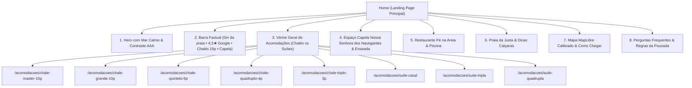

# PROPOSTA V2 — Pousada Eliiy Zita Pedro (Com Correções Auditadas)

**Documento Consolidado de Planejamento, Arquitetura e Engenharia de Vendas**  
**Data:** 28/10/2026  
**Status:** ⛔ **PAUSADO NO PORTÃO V2 — AGUARDANDO APROVAÇÃO FINAL DO USUÁRIO**  
*Nenhuma linha de código será escrita antes da sua aprovação explícita deste plano corrigido.*

---

## 1. Saneamento Facto-a-Facto: Dados Reais vs. Pendências Auditadas

Aplicando rigor absoluto e excluindo qualquer estimativa ou extrapolação:

### A. Nota do Google Meu Negócio (Zero Invenção)
- **Correção Efetuada:** O número "4.4★" foi eliminado (era uma estimativa média da auditoria anterior).
- **Dado Real Coletado via Playwright MCP em 28/10/2026:**
  - **Nome Oficial no Google Maps:** `Pousada e Restaurante EIiiy Zita Pedro`
  - **Nota Real:** **4,3 ★**
  - **Total de Avaliações Reais:** **117 avaliações**
  - **Endereço Registrado:** `R. Maria José de Jesus, 3006 - Ubatumirim, Ubatuba - SP, 11680-000`
  - **Telefone Registrado:** `(12) 99232-3556` | **Check-out:** `11:00`
  - **Link Direto:** [`Ver no Google Maps`](https://www.google.com/maps/place/Pousada+e+Restaurante+EIiiy+Zita+Pedro/@-23.3347963,-44.897125,17z/data=!4m9!3m8!1s0x9d5d82796828cf:0x6d5093858fabfc5!5m2!4m1!1i2!8m2!3d-23.3347963!4d-44.897125!16s%2Fg%2F11m7pw2z_5)
- **Apresentação no Site:** *"4,3 ★ no Google (117 avaliações reais)"* com link direto para o perfil público do Google Maps, ou *"Avaliada no Google com mais de 100 avaliações de hóspedes"*.

### B. Auditoria de Fatos, Capela e Arredores
| Fato Mencionado | Fonte Confirmada | Decisão no Site |
|---|---|---|
| **"Capela Nossa Senhora dos Navegantes"** | **Confirmado:** Fachada azul celeste com letreiro explícito nos minutos `00:01` e `00:09` do vídeo `WhatsApp Video 2026-10-25 at 12.18.27.mp4`. Dona Zita cita a existência da capela aos `01:13` do áudio. | **Mantido** no site como ponto de contemplação e identidade local. |
| **"Caminhada até a Praia da Justa"** | **Confirmado:** Narração do vídeo tour aos `00:06` e `00:37 / 00:53` (*"praia deserta bem próxima à Praia da Justa... caminhando pelo lado direito"*). | **Mantido** como dica de passeio ecológico a pé pela areia. |
| **"Casamentos na Capela"** | **Parcialmente Citado:** O narrador do vídeo Kwai afirma aos `00:08` (*"tem até uma capela que você pode realizar casamentos"*), porém Dona Zita não confirmou formalmente se aceita locação para eventos/casamentos. | **`[A CONFIRMAR com a Zita]`** — Não será anunciado como pacote comercial até ela autorizar formalmente. |
| **"Capela Histórica"** | **Sem Fonte:** Nenhum registro oficial atesta o tombamento ou ano histórico da capela. | **Removido** o adjetivo "histórica". Será tratada como "Capela própria à beira-mar". |
| **"Jardim de 1.000 m²"** | **Sem Fonte:** Número não existe no áudio nem nos vídeos catalogados. | **Removido** do site. Será citado apenas como "amplo jardim tropical com coqueiros". |

---

## 2. Auditoria de Mídia e Direitos de Uso (Vídeo Tour)

Inspecionamos detalhadamente o arquivo `WhatsApp Video 2026-10-25 at 12.18.27.mp4` (62.7s):
1. **Origem da Mídia:** Vídeo originalmente publicado no **Kwai** pelo canal parceiro `@ubatubaeomundo` (marca d'água visível no canto da tela e encerramento comercial aos 01:00).
2. **Áudio e Trilha:** Narração comercial e trilha sonora de terceiros protegida por direitos da plataforma.
3. **Pessoas Identificáveis:**
   - Aos `00:38`, aparece uma influenciadora/banhista em primeiro plano sorrindo na praia ao lado de uma escultura.
   - Aos `00:25` e `00:28`, aparecem famílias e hóspedes almoçando no restaurante e sentados na areia.
4. **Decisão Estrita de Publicação (Zero Risco Jurídico):**
   - ❌ **Proibido:** Incorporar o vídeo tour completo com som e com a marca do Kwai/terceiros no site.
   - ❌ **Proibido:** Publicar imagens em primeiro plano de pessoas sem autorização de imagem expressa.
   - ✅ **Permitido:** O Agente 08 (Editor de Mídia) extrairá exclusivamente cortes de B-roll (imagens de drone da enseada, ondas calmas, fachada da pousada e cômodos vazios), gerando loops WebM/MP4 mudos, sem marcas d'água e ultra-comprimidos para carregar instantaneamente.
   - ✅ **Mídia Segura:** Uso preferencial dos outros 20 vídeos do acervo gravados internamente por Dona Zita mostrando quartos e chalés.

---

## 3. Arquitetura de Acomodações: Rotas Reais Individuais

Em vez de simples modais flutuantes, cada acomodação possuirá sua **página/rota real independente**, estruturada para SEO local, compartilhamento direto no WhatsApp e indexação:

### Categoria A: Chalés com Cozinha Privativa (Autonomia & Grupos)
1. **`/acomodacoes/chale-master-15p`** (Chalé Master para até 15 pessoas, dois pavimentos, cozinha completa, mesa grande e sala).
2. **`/acomodacoes/chale-grande-10p`** (Chalé Grande Família para até 10 pessoas, cozinha completa).
3. **`/acomodacoes/chale-quinteto-5p`** (Chalé para até 5 pessoas com cozinha).
4. **`/acomodacoes/chale-quadruplo-4p`** (Chalé para 4 pessoas com cozinha equipada).
5. **`/acomodacoes/chale-triplo-3p`** (Chalé aconchegante para 3 pessoas com cozinha).

### Categoria B: Suítes Tradicionais (Conforto sem Cozinha)
6. **`/acomodacoes/suite-casal`** (Suíte Casal com cama box, ar-condicionado, varanda e frigobar).
7. **`/acomodacoes/suite-tripla`** (Suíte para 3 pessoas com ar-condicionado e banheiro com blindex).
8. **`/acomodacoes/suite-quadrupla`** (Suíte Quádrupla com cama de casal + beliche, varanda e ar).

### Conteúdo Mandatório de Cada Rota:
- **Galeria Real:** Fotos e vídeo curto da unidade específica (sem simulação de IA).
- **Ficha Técnica Confirmada:** Capacidade máxima, tipo de cama, ar-condicionado split, frigobar/cozinha, presença de churrasqueira (se aplicável), voltagem e regras de convivência.
- **Políticas Claras:** Horário de check-in / check-out (`11:00`), silêncio noturno, pet friendly `[A CONFIRMAR]`.
- **Motor de Cotação WhatsApp:** Sem preço inventado. Formulário com seletor de datas e número de pessoas que gera link para o WhatsApp de Dona Zita:
  > *"Olá Dona Zita! Gostaria de consultar a disponibilidade e valor do [Nome da Acomodação] para [X] pessoas no período de [Data de Entrada] até [Data de Saída]."*

---

## 4. Tipografia & Identidade Visual Anti-Slop

### Eliminação de Fontes Genéricas de IA:
- Banimento total da `Plus Jakarta Sans`, `Inter`, `Roboto` ou qualquer tipografia associada a dashboards corporativos ou templates genéricos de IA.

### Sistema Tipográfico Exclusivo (Derivado da Marca e Tradição Caiçara):
- **Títulos (Display & H1/H2):** **`Cormorant Garamond`** ou **`Cinzel`** — serifas nobres com acabamento editorial de alta costura, inspiradas em retiros à beira-mar e hotéis boutique mediterrâneos (referência ERA Residence e Cheval Blanc).
- **Textos de Apoio e Parágrafos (Body):** **`Cabinet Grotesk`** ou **`Outfit`** — tipografia limpa, geométrica e acolhedora, com alto índice de legibilidade em telas móveis e sob sol intenso na praia.
- **Paleta de Apoio (Natureza de Ubatumirim):**
  - Verde Mata Fechada (`#1e3d34`) — Base de autoridade e acolhimento.
  - Azul Límpido da Enseada (`#0284c7`) — Remetendo ao mar calmo de Ubatumirim e à Capela.
  - Areia Quente / Sand Parchment (`#f8f5f0`) — Fundo respirável de alto contraste.
  - Ocre / Sol Caiçara (`#f59e0b`) — Acento exclusivo para CTAs de reserva e WhatsApp.

---

## 5. Protocolo Motion: Adaptação da `scroll-craft` (CEREBRO)

Conforme estabelecido em [`CEREBRO/scroll-craft-adaptacao.md`](file:///c:/Users/Teste/Downloads/MEGA-ESTRUTURA-AGENTE-SITE/CEREBRO/scroll-craft-adaptacao.md):

1. **Escopo Restrito a 2 Momentos:**
   - **Momento 1 (Hero):** Revelação suave do horizonte e título com inércia controlada via `Lenis`.
   - **Momento 2 (Galeria de Acomodações):** Ancoragem suave (*sticky pinning*) enquanto o hóspede desliza pelas categorias de chalés e suítes.
2. **Resiliência a Sinal Fraco (3G/4G de Ubatumirim):**
   - Zero dependência de bibliotecas 3D pesadas (Three.js/WebGL dispensados para este projeto).
   - Carregamento de scripts de animação com `defer`.
   - Fallback instantâneo em caso de conexão instável: se o script não inicializar em 800ms, as seções operam no layout estático limpo sem nenhum travamento.
3. **Acessibilidade (`prefers-reduced-motion`):**
   - Transições de scroll totalmente desligadas para usuários com redução de movimento ativada.
4. **QA Visual e Performance (Agente 06):**
   - Pontuação no Google Lighthouse Mobile ≥ 90.
   - Verificação com simulação de 4G lento e screenshots no Playwright a cada etapa de rolagem.

---

## 6. Mapa do Site V2

---

## 7. ⛔ PORTÃO V2 — SOLICITAÇÃO DE APROVAÇÃO FINAL

Todas as 5 correções exigidas foram aplicadas, o arquivo [`CEREBRO/scroll-craft-adaptacao.md`](file:///c:/Users/Teste/Downloads/MEGA-ESTRUTURA-AGENTE-SITE/CEREBRO/scroll-craft-adaptacao.md) foi gravado e a nota real do Google (4,3★ com 117 avaliações) foi verificada no Google Maps via Playwright.

**Você concede a APROVAÇÃO FINAL para iniciarmos o desenvolvimento da V2 com esta arquitetura?**
*(Responda com "Aprovado final" ou faça suas considerações).*
